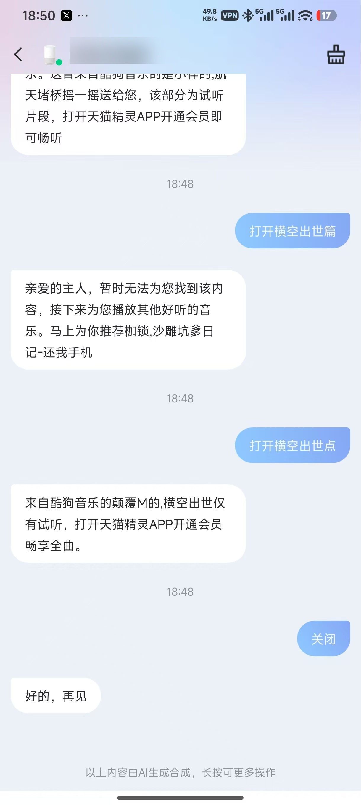
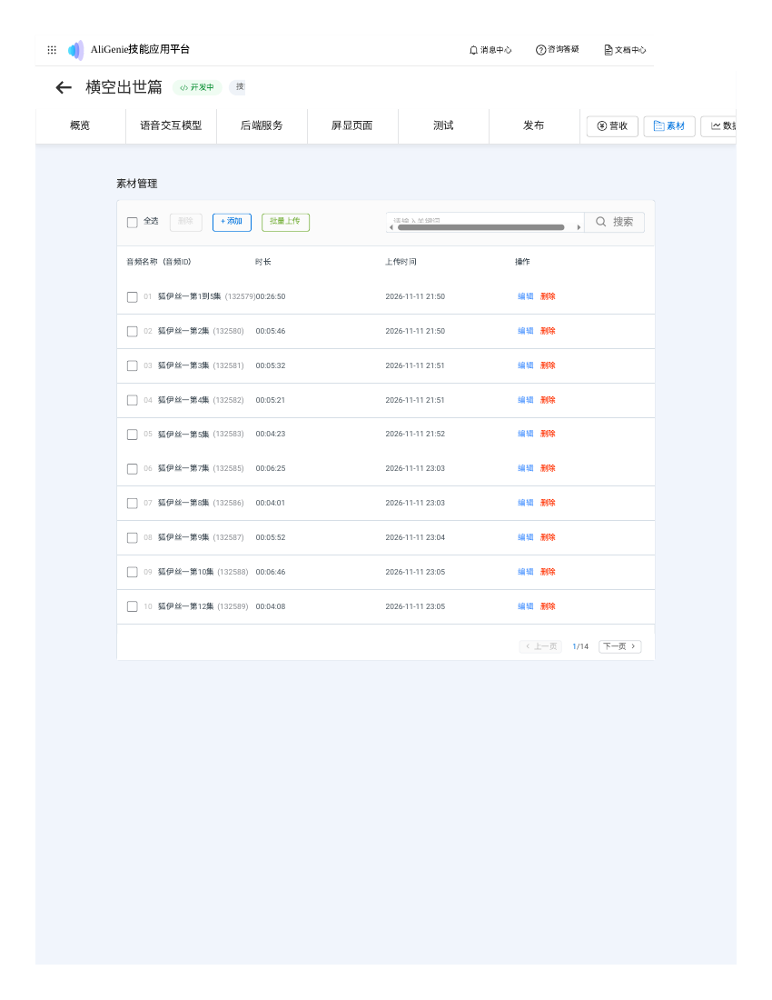
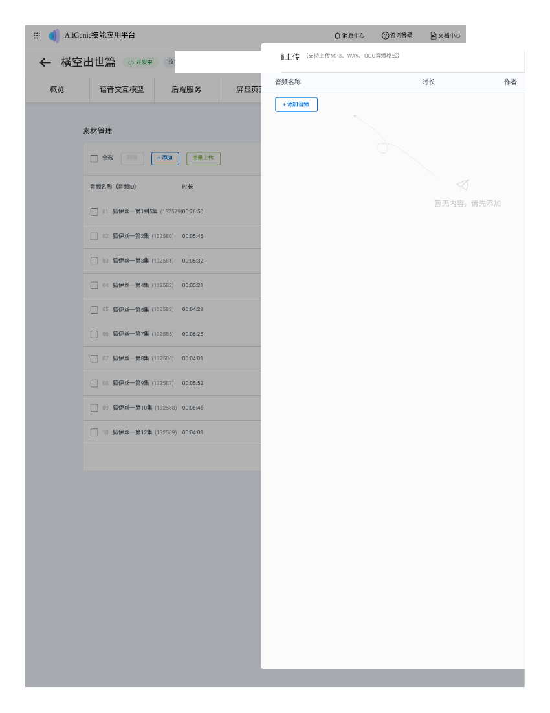
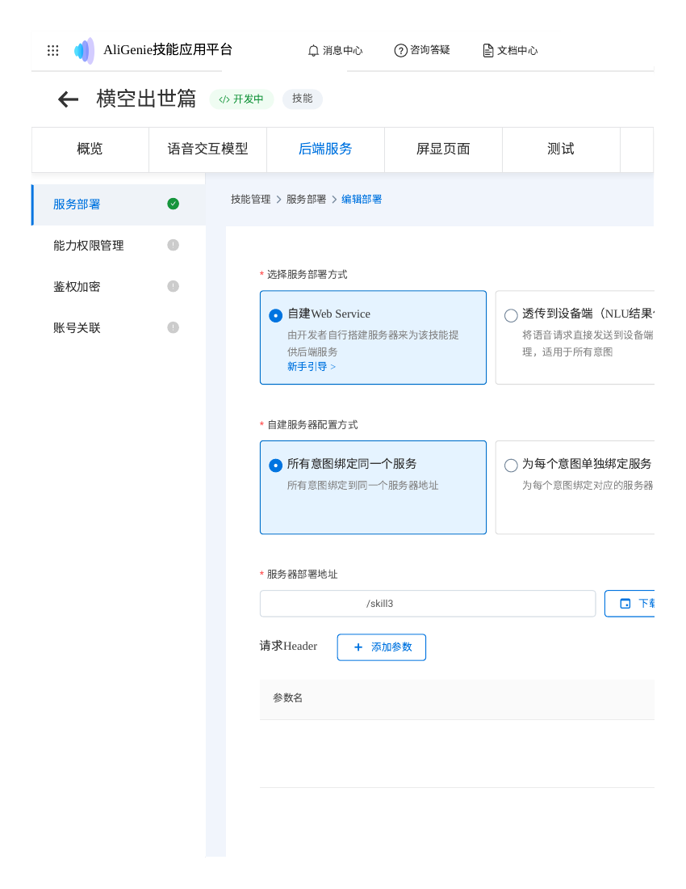
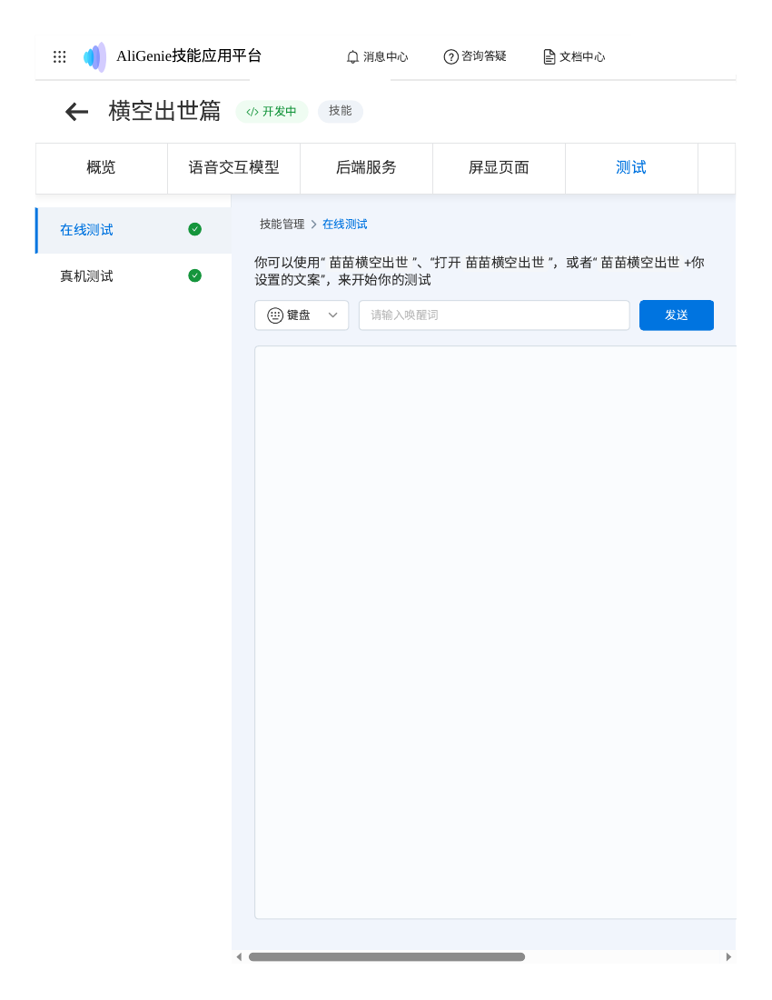

# 给天猫精灵做一个能按集数点播的听故事技能

> Make your Tmall Genie play any episode of an audio story by voice — an AliGenie custom skill with a self-hosted webhook, supporting episode-by-episode playback and 5-episode continuous play.
>
> 关键词：天猫精灵 自定义技能 按集点播 有声剧 儿童故事 AliGenie Tmall Genie custom skill episode playback audiobook smart speaker

孩子想听的有声剧在网盘里，天猫精灵打不开网盘；原发平台要会员；市面上的模板技能只能从第一集顺着播，想听哪集全靠运气。最后我跟 AI 一起做了个技能：孩子喊「打开万千世界篇」「播放第五十一集」，音箱直接播那一集，还能五集连着放。

## 能做到什么

- 孩子喊「打开某某」「播放第五十一集」，音箱直接播那一集，不用从第一集顺着听
- 喊每五集的第一集（第 1、6、11 集……）播整块，五集连着放
- 一个系列一个技能，多个系列互不干扰
- 中文数字也认得：「第五十一集」「第一百零二集」都能听懂

这篇是我这个测试者的复盘：我负责拍板、验货，动手的全是 AI。按这个路子，第一季 136 集、第二部 113 集、第二季前 138 集的一大半都做通了，孩子天天在听。你照着抄，大概率也能一次做通。

## 先说一句重要的：这套东西必须配合 AI 来做

步骤多、细节更多——对照表、中文数字解析、五集拼块、改名过审、校验文件，哪一步手滑都得重来，手工操作基本没戏。**`SKILL.md` 就是给 AI 用的操作手册**：把它交给你的 AI 助手（Muse、Claude 之类），给它一个目标，它自己按步骤跑、自己测试；需要你授权或配合时它再来找你，你最后真机验收就行。`backend/miao-skilld.py` 是后端参考实现，`corpus_import.csv` 是语料批量导入模板，`img/` 里是操作过程的实拍图（账号名和应用 ID 已做屏蔽处理）。

## 准备工作：开工前备齐这几样

- **一个淘宝账号，必须是家里天猫精灵绑定的那个。**后面登录开发者平台、绑测试设备都用它，账号要完成实名。登录这一步是在 AI 那边完成的：密码放在保险库里，AI 看不到明文。有一点要提前知道——AI 是在境外机器上登录淘宝，境外 IP 很容易触发淘宝的风控，登录时可能要短信验证码、人脸验证，这些只能你本人配合做。万一反复登不上，也别硬试，换国内网络、或者你自己在电脑上登一次，让 AI 接着往下走。
- **一台国内服务器，跑后端用。**我们用的是阿里云轻量（杭州）。海外服务器不行：平台在国内取不到校验文件，链路直接死。服务器地址只填 IP、不要填域名，域名没备案会被云厂商拦截。
- **故事音频。**两个办法都行。第一，从百度网盘下：把网盘链接和目录告诉 AI，它能在服务器上用下载工具慢慢拉下来，几百集要拉好几个小时，限速是百度那边给的，急不得。第二，你自己先下载好，传到谷歌云盘之类的地方，再让 AI 去取——我们就是这么备用的，因为我们有阿里云，音频先落到阿里云上再往下走，省事。如果你没有阿里云，那就得自己找个盘来承接：音频得先有个地方落脚、后端也得有个地方跑，缺了这两样，AI 手里没料也做不了。除了百度云，其他云盘估计也行，只要 AI 能读到文件。
- **一台天猫精灵音箱**，绑在上面那个淘宝账号下。测试的时候人要在音箱边上，喊一嗓子就知道通没通。
- **时间。**第一遍别赶，留足一下午。最花时间的是传音频，一百多集传完、再抽验，怎么也得两三个小时。

## 第二步：怎么跟 AI 沟通

其实不用每一步都跟 AI 沟通。我的做法是：一次给它一个目标——比如「做第二季，一共 138 集，音频在百度网盘这个目录，调用词叫『苗苗一鸣惊人』」——剧名、集数、文件在哪、想叫什么，一次说清，然后它自己去跑、自己去测试，中间不用每步汇报。

只有需要授权的时候它才来找你：登录要短信验证、要你本人配合的步骤、要花钱的步骤，这些它自己办不了，你给它授权、配合一下就行。

你最后验收：真机上喊几嗓子，播对了就行。它自己会用在线测试和后端日志验，错了自己调；实在调不通、需要你拿主意的时候，它会把情况和选项摆出来，你拍板。

方向错了就纠正，别客气。AI 第一遍的判断经常不准：它一开始认定旧技能坏在调用词撞名，我按它的方向查了半天，最后还是靠后端日志零请求这个铁证，才定责是技能本身坏了；第 64、89 集被拦那次，也是我点破「卡的是标题里的阿拉伯数字」它才改对方向。你的现场信息（音箱回了什么、孩子喊了什么）比它的推测值钱。

## 全流程：我做什么、AI 做什么

**第一步，建技能。**你定技能名和调用词，AI 去开发者平台新建「自定义技能」，分发设备勾精灵音箱，后端选自建 Web Service。调用词最娇气：「苗苗点播」被音乐应用当点歌截走，「狐伊丝」孩子喊出来被听成「福利斯」，「魔法少女」被精灵内置的同名试听节目接走。最后按系列名定成「万千世界篇」才稳住。经验就三条：用常用字，别撞现成的歌名、节目名，别用生造组合。

**第二步，配意图和语料。**AI 建一个「播放」意图，设为默认意图，加参数「集数」。语料千万别在网页上手打：手打的会被存成「例句」，里面的 {集数} 只是几个字，变不成能填数字的槽位。正确做法是走官方批量导入，一个 GBK 编码、分号分隔的 CSV，模板行写成「播放第@{集数}集」，再配几行中文数字的示例。导入完、保存意图，还有最后一下：点意图页上的「语音交互模型训练」。导入不等于训练，不点这个按钮，模型根本不生效，在线测试怎么测都是「对不起，我暂时还不支持这项功能」。

**第三步，写后端、放校验文件、填服务地址。**这三件事 AI 一起办：后端逻辑就是收到集数、查对照表、回一个播放动作；平台要验证后端是你的，它给每个技能一份校验文件，文件名是技能 ID 的 MD5 值加 .txt 后缀，放到后端能公开取到的路径上，注意平台用 HEAD 方法来探，HEAD 也得返回 200；服务地址只填 IP。我这边卡得最久的就是这一步：后端放海外，平台在国内根本取不到校验文件；用域名，域名没备案被拦截，要么回 403 的备案提示页，要么接通了立刻掐断。最后全改成 http://服务器IP/路径 才保存成功。保存完在在线测试里连测三句，后台日志里能看到请求进来、回复对得上，才算链路通了。

**第四步，传音频、建对照表。**音频在技能的「素材 → 音频素材」里传。批量上传入口我们后来才发现：工具栏上有个「批量上传」按钮，但中文名的文件会被它拒收，报「暂不支持该文件类型」；办法是英文名文件批量进、逐行改中文素材名、一次保存全传。单条「+ 添加」也行，就是慢。还有一个坑：批量上传时「作者」字段必填，空着会静默失败——没有任何报错、列表里也不留记录，整批传完像没传过一样；作者统一填一个就行（我们填的是「苗苗绘本」）。每传一条，把平台给的音频 ID 记进对照表；传完了把对照表填进后端、重启服务。再回在线测试点一集，能出现真实的音频播放器和时长，就算接上了。素材列表里时长显示 00:00:00 是列表的显示毛病，音频本身没坏，看在线测试里的时长为准。

**第五步，真机绑设备、验收。**这一步最容易漏，而且漏了之后症状特别像调用词的问题。真机测试总开关要打开；模式别选「直接使用账号下设备」，那个模式选上不落库、一刷新就弹回去。用手动添加：对音箱说「打开技能测试」，它会念一串验证码，三分钟内把码填进控制台，设备就绑上了。人在音箱边喊「打开万千世界篇」「播放第几集」，同时盯后端日志：真机请求会带着所在地和会话信息进来。日志里看到请求、音箱播对集数，才算全线打通。

**第六步，五集连播。**平台没有官方连播机制，一次回复只能播一条音频。变通办法在服务端：把相邻五集拼成一条长音频上传，喊块的第一集播整块（二十分钟左右），喊块中间的集数还是播单集。拼之前先用 ffprobe 看一眼源文件：下载下来的「MP3」可能只是个壳，实际是 M4A 格式，直接流拷贝拼会全部失败，要转码成真 MP3 再拼。

## 避坑清单

- 第 64 集和第 89 集的音频单独传会被平台以「敏感词」拦下来。两季都是这两个集号中招，内容完全不同，卡的是标题里的阿拉伯数字编号。把名字改成汉字数字（第六十四集、第八十九集）重传就过了。包含这两集的五集拼块因为名字是区间写法，不受影响。
- 新技能建好尽快绑设备、尽快真机验，别晾着。旧技能就是建好后晾了一天多才绑设备，等发现唤不进的时候，已经分不清是配置问题还是技能本身坏了。最后查下来是技能本身在平台侧的状态异常：从建好那天起，唤醒请求就一次都没到过后端，换调用词也没用，只能重建。重建的新技能一次就通。
- 技能音频暂停后按「继续」，会跳回天猫精灵自家的音频。暂停、继续都是音箱本地处理，后端收不到请求，平台限制，改不了。想继续听就再喊一句「打开某某，播放第几集」重播那一集。
- 在线测试里唤醒句的回复气泡空白，不一定是坏了，可能是测试面板渲染不出这种回复；判断链路通没通，看后端日志有没有请求进来，别只看气泡。
- 发布信息（图标那些）不用填，不影响真机测试使用。

## 现场图（以下 5 张图都来自我们实际操作过程：图 1 是我用手机拍的音箱现场，其余 4 张是操作时控制台页面的实拍保存）

图 1：旧技能唤不进时的现场。喊「打开横空出世篇」，音箱先是找不到内容，接着给出了酷狗音乐里同名歌曲的试听。这张图就是我们后来定责的起点。

图 2：音频素材列表。传完的音频都在这里，每条带音频 ID 和时长；对照表里的编号就是从这里抄的。工具栏上那个绿色的「批量上传」就是后来才发现的批量入口。

图 3：批量上传弹窗。英文名文件批量进、逐行点铅笔改中文素材名，一次保存全传。中文名文件在这一步会被直接拒收，弹窗里一行都进不去。

图 4：服务部署页。部署方式选「自建 Web Service」、配置方式选「所有意图绑定到同一个服务」，地址只填服务器 IP；校验文件放好后，点保存，平台会先去取校验文件再放行。

图 5：在线测试页。唤醒句、点播句在这里先测一遍，后端日志里能看到请求进来，回复对得上，再去真机上喊。

## 总结清单

开工前：淘宝账号（绑音箱那个、已实名）已备好；音箱在手边；音频来源已定（百度网盘拉取，或自己下好放谷歌云盘等 AI 去取）；国内服务器已备好（有阿里云最好，没有就自己找盘承接）；一下午的时间已留出来。

建技能：调用词用常用字、不撞歌名节目名；意图配好、语料批量导入、点了「语音交互模型训练」；后端、校验文件、服务地址（只填 IP）三件套已通，在线测试三句全过、后端日志有请求。

传音频：批量上传用英文名文件、逐行改中文名；64、89 集用汉字数字；每条音频 ID 记进对照表；对照表填进后端、重启；在线测试点一集能播。

真机：总开关打开、手动绑设备（验证码三分钟内填）；建好当天就验真机；喊块首集播整块、喊块内集数播单集。

出问题先查后端日志：有请求进来是配置问题，没请求进来先怀疑技能本身，换调用词没用就重建，别死磕。
